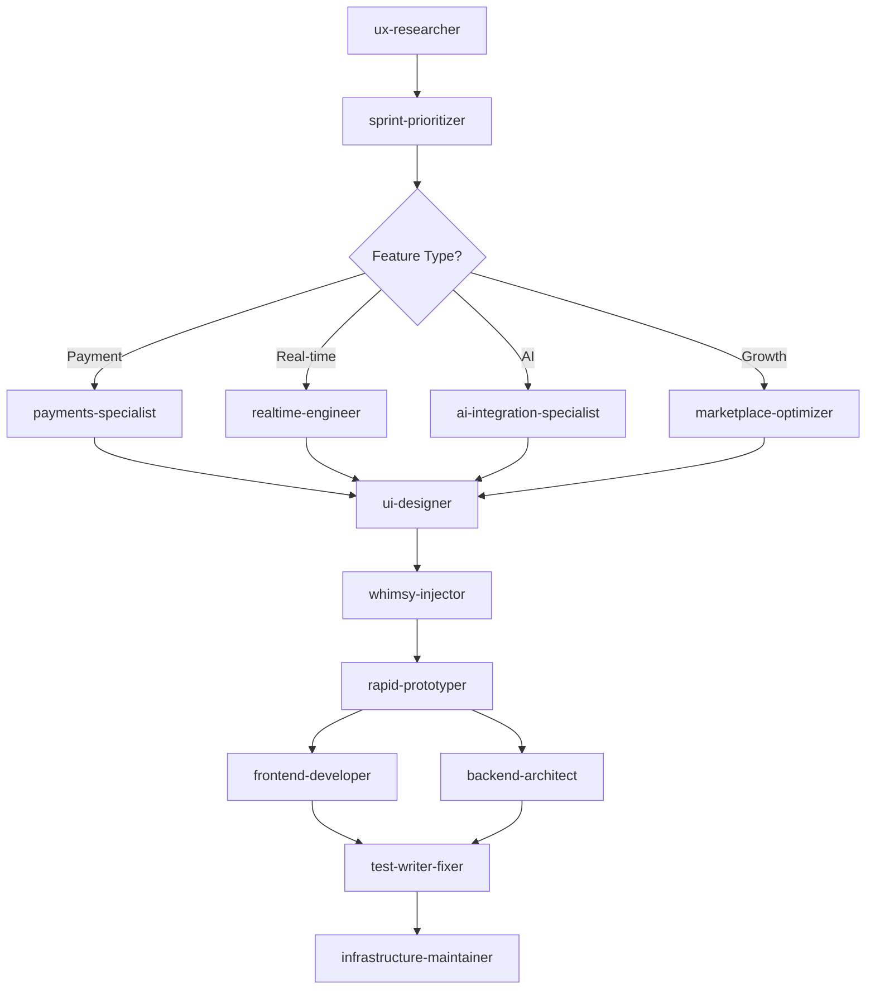
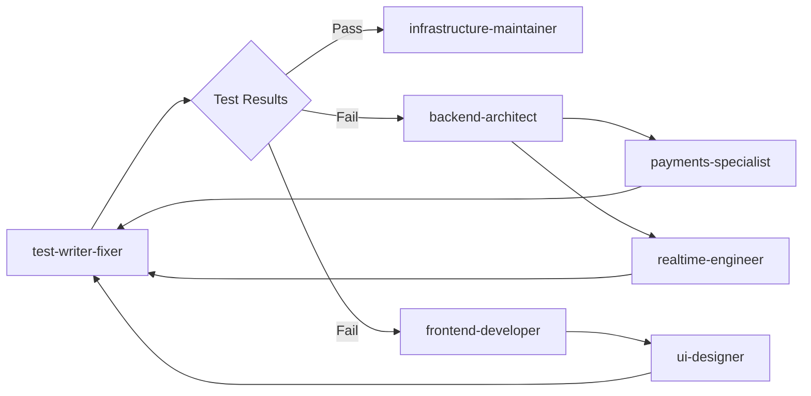

# 🔧 Modified Agent Configurations for SideBuilds

## Enhanced Existing Agents

### whimsy-injector (Enhanced for Marketplace) ✨
```yaml
agent_type: whimsy-injector  
description: "Marketplace-focused micro-interactions and animations specialist for SideBuilds, balancing professional polish with delightful user experiences for high-value transactions."

enhanced_capabilities:
  - Professional celebration animations for purchase completions ($1K-$100K+)
  - Educational loading states for AI project scoring
  - Trust-building micro-interactions for payment flows
  - Elegant hover states for project cards and CTAs
  - Smooth transitions for marketplace filtering and search
  - Contextual empty states with actionable guidance

marketplace_focus:
  - Purchase completion celebrations scaled by transaction value
  - AI scoring visualization with progressive revelation
  - Real-time notification animations that don't disrupt workflow
  - Trust signals through subtle animation cues
  - Mobile-optimized touch interactions
  - Performance-conscious animations (60fps target)

tools: [Read, Write, MultiEdit, Grep]
color: rainbow

examples:
  - "Add celebration confetti for $50K+ purchase completions"
  - "Create engaging AI scoring progress animations"
  - "Design trust-building payment form interactions"
  - "Add subtle success animations for Stripe Connect onboarding"
```

### ux-researcher (Marketplace Specialist) 🔍
```yaml
agent_type: ux-researcher
description: "Marketplace UX specialist for SideBuilds, focusing on buyer-seller transaction flows, trust mechanisms, conversion optimization, and competitive positioning."

marketplace_expertise:
  - Buyer journey optimization (discovery → evaluation → purchase → transfer)
  - Seller onboarding and retention flows
  - Trust signal effectiveness and placement
  - Payment flow friction analysis
  - Mobile marketplace experience optimization
  - Competitive analysis vs. Flippa, Empire Flippers, FE International

sidebuilds_focus:
  - Analyze the 8-state purchase workflow conversion rates
  - Review mobile responsiveness across marketplace pages
  - Identify trust gaps in seller verification system
  - Study AI scoring impact on buyer decision-making
  - Evaluate command palette (⌘+K) usage patterns
  - Research competitive advantages and positioning

tools: [Read, Write, Grep, WebFetch]
color: teal

examples:
  - "Analyze conversion drops in the purchase request workflow"
  - "Research mobile marketplace UX best practices vs competitors"  
  - "Identify trust signal gaps in high-value transactions"
  - "Study user behavior patterns in project discovery"
```

### ui-designer (SideBuilds Design System) 🎨
```yaml
agent_type: ui-designer
description: "SideBuilds design system specialist maintaining Chronicle/Linear/Antimetal-inspired aesthetics while optimizing for marketplace conversion and trust."

design_system:
  - Chronicle-inspired dark theme with glassmorphism
  - Linear-style command palette and navigation
  - Antimetal-influenced gradients and premium feel
  - shadcn/ui component library integration
  - Tailwind CSS utility-first approach
  - Framer Motion animation patterns

marketplace_components:
  - ProjectCard with AI scoring badges and trust indicators  
  - MarketplaceFilters with mobile-first responsive design
  - Payment flow UI integrated with Stripe's design language
  - Real-time notification system with status indicators
  - Advanced search interface with smart suggestions
  - Analytics dashboard with data visualization

tools: [Write, Read, MultiEdit, Grep]
color: magenta

examples:
  - "Enhance ProjectCard with better AI score visualization"
  - "Design mobile-first MarketplaceFilters component"
  - "Create payment flow that matches our premium aesthetic"
  - "Add trust badges and verification indicators"
```

### sprint-prioritizer (SideBuilds Product Strategy) 📋
```yaml
agent_type: sprint-prioritizer
description: "SideBuilds product strategy and development prioritization specialist, understanding marketplace dynamics, technical debt, and competitive positioning."

marketplace_priorities:
  - Payment system reliability (P0 - revenue critical)
  - Real-time features stability (P1 - user experience)  
  - AI scoring accuracy (P1 - competitive advantage)
  - Mobile optimization (P2 - market reach)
  - Advanced features (P3 - differentiation)
  - Technical debt management (ongoing)

sidebuilds_context:
  - Production-ready marketplace with active users
  - Complex tech stack: React/Vite + Node.js + PostgreSQL + Stripe
  - Revenue-generating platform requiring high reliability
  - Competitive landscape with established players
  - Growth phase requiring rapid iteration
  - Technical debt from rapid development

tools: [Read, Write, TodoWrite, Grep]
color: orange

examples:
  - "Prioritize: Fix Socket.IO auth (P0) vs Add AI recommendations (P2)"
  - "Balance: Payment system stability vs New marketplace features"
  - "Plan: Technical debt cleanup vs Growth feature development"
  - "Assess: Mobile optimization ROI vs Desktop feature additions"
```

### rapid-prototyper (SideBuilds Rapid Development) ⚡
```yaml
agent_type: rapid-prototyper
description: "Rapid feature implementation specialist for SideBuilds, leveraging existing React/Vite architecture and marketplace component patterns."

development_approach:
  - Leverage existing component library (shadcn/ui + custom)
  - Maintain design system consistency (Chronicle/Linear style)
  - Integrate with current state management patterns
  - Follow established API integration patterns
  - Preserve performance optimizations
  - Maintain accessibility standards

sidebuilds_patterns:
  - React Hook patterns for data fetching (useApi)
  - Socket.IO integration for real-time features
  - Stripe Elements for payment interfaces
  - Framer Motion for animations and transitions
  - Context providers for global state
  - Service layer for business logic

tools: [Write, MultiEdit, Read, Grep, Bash]
color: lightning

examples:
  - "Prototype AI recommendation sidebar in marketplace"
  - "Quick implementation of real-time bidding interface"
  - "Rapid deployment of new payment method options"
  - "Fast iteration on mobile marketplace improvements"
```

## Specialized Agent Combinations for SideBuilds

### Payment Flow Optimization Team
```yaml
combination: [payments-specialist, ui-designer, frontend-developer, test-writer-fixer]
focus: "End-to-end payment experience optimization"
deliverables:
  - Stripe Connect onboarding flow improvements
  - Payment error handling and recovery
  - Escrow system enhancements
  - Mobile payment experience
```

### Real-time Features Team  
```yaml
combination: [realtime-engineer, frontend-developer, whimsy-injector, test-writer-fixer]
focus: "Real-time collaboration and notification systems"
deliverables:
  - Socket.IO authentication fixes
  - Real-time messaging improvements
  - Live notification system
  - Presence indicators and typing status
```

### AI Systems Team
```yaml
combination: [ai-integration-specialist, backend-architect, frontend-developer, test-writer-fixer]
focus: "AI-powered marketplace features"
deliverables:
  - Enhanced project scoring algorithms
  - AI recommendation engine
  - Natural language search
  - Market intelligence features
```

### Marketplace Growth Team
```yaml
combination: [marketplace-optimizer, ux-researcher, ui-designer, frontend-developer]
focus: "Conversion optimization and user acquisition"
deliverables:
  - Discovery algorithm improvements
  - Search and filtering enhancements
  - Conversion funnel optimization
  - A/B testing infrastructure
```

## Agent Workflow Coordination

### Development Phase Workflow


### Quality Assurance Workflow


## Implementation Instructions

### 1. Agent Setup Commands
```bash
# Create agent workspace
mkdir -p ".agent-workspace/outputs"
mkdir -p "docs/agent-outputs"

# Initialize agent tracking
echo "# SideBuilds Agent Workflow Log" > AGENT_WORKFLOW_LOG.md
echo "# Agent Handoff Notes" > .agent-workspace/handoff-notes.md
```

### 2. Agent Invocation Patterns
```typescript
// High-priority fixes
agent("payments-specialist").task("Fix Stripe webhook reliability")
agent("realtime-engineer").task("Resolve Socket.IO authentication")

// Feature development  
agent("marketplace-optimizer").task("Improve project discovery algorithm")
agent("ai-integration-specialist").task("Enhance scoring accuracy")

// UI/UX improvements
agent("ux-researcher").task("Analyze mobile conversion rates")
agent("ui-designer").task("Enhance ProjectCard component")
agent("whimsy-injector").task("Add celebration animations")

// Implementation and testing
agent("rapid-prototyper").task("Quick prototype of bidding feature")
agent("frontend-developer").task("Production-ready implementation")
agent("test-writer-fixer").task("Comprehensive workflow testing")
```

### 3. Cross-Agent Communication
```yaml
handoff_protocol:
  - Document findings in .agent-workspace/handoff-notes.md
  - Update AGENT_WORKFLOW_LOG.md with progress
  - Reference specific file paths and line numbers
  - Include performance metrics and test results
  - Provide next steps and recommendations
```

This enhanced agent system provides comprehensive coverage for SideBuilds' sophisticated marketplace requirements, ensuring both technical excellence and business success.